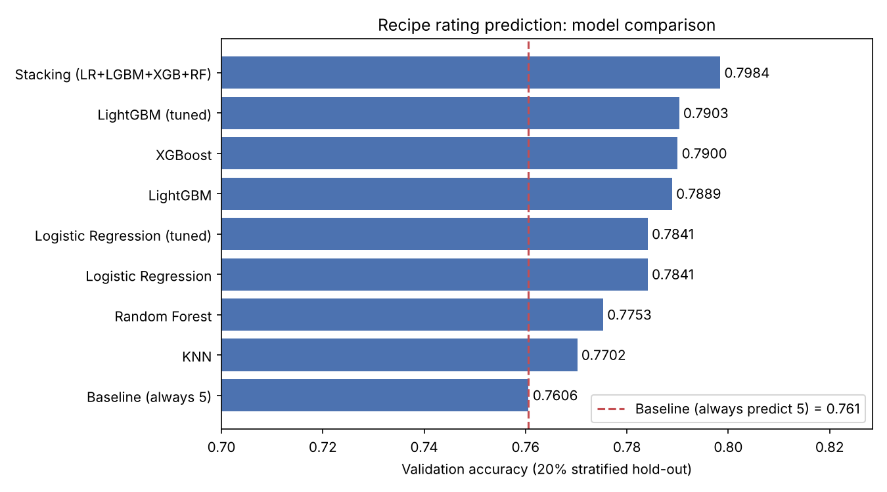

🧠 Recipe Rating Prediction

📌 Overview

This project develops a machine learning model that predicts recipe ratings based on user reviews and engagement metrics.
It combines NLP for text reviews and structured feature engineering for numerical and categorical attributes.

🎯 Objective

To predict user ratings (1–5 scale) using review text and user behaviour data with advanced ensemble models.

⚙️ Workflow

Data Preprocessing & EDA

Missing value handling, outlier analysis, feature correlations.

Feature Engineering

One-hot encoding, scaling, and TF-IDF vectorization for text.

Model Building

Logistic Regression, KNN, Random Forest, LightGBM, XGBoost, Bagging, and Stacking.

Hyperparameter Tuning

Performed via RandomizedSearchCV for optimal performance.

Evaluation

Accuracy score and confusion matrix comparison across models.

📊 Model Comparison

  

📈 Top Models: Stacking, LightGBM, XGBoost
✅ Best Accuracy: 0.80004

🧰 Tech Stack

Languages: Python

Libraries: pandas, numpy, scikit-learn, lightgbm, xgboost, matplotlib

Concepts: NLP, TF-IDF, Model Stacking, Hyperparameter Tuning

🚀 Future Scope

Integrate deep learning models (LSTM/BERT) for richer text understanding

Deploy via Flask for real-time rating prediction